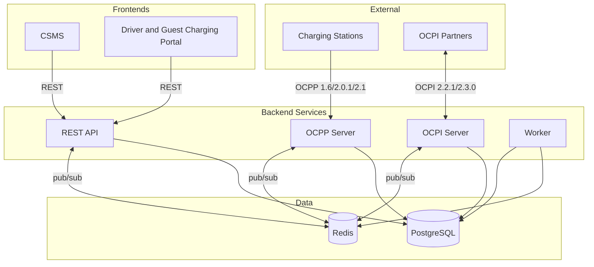

<p align="center">
  
</p>

<h1 align="center">EVtivity CSMS</h1>

<p align="center">
  <a href="https://github.com/EVtivity/evtivity-csms/releases/latest"></a>
  <a href="https://github.com/EVtivity/evtivity-csms/actions/workflows/ci.yml"></a>
  <a href="https://github.com/EVtivity/evtivity-csms/actions/workflows/ci.yml?query=branch%3Amain"></a>
  <a href="https://github.com/EVtivity/evtivity-csms/blob/main/LICENSE.md"></a>
  
  
  
  
</p>

<p align="center">
  <a href="README.md">English</a> ·
  <a href="README.de.md">Deutsch</a> ·
  <a href="README.es.md">Español</a> ·
  <a href="README.ko.md">한국어</a> ·
  <a href="README.zh.md">简体中文</a> ·
  <strong>繁體中文</strong>
</p>

EVtivity 是一個 AI 驅動的電動車充電平台。其核心是一套相容 OCPP 1.6、2.0.1 與 2.1 的充電樁管理系統（CSMS），用於電動車充電基礎設施。系統支援與充電樁的即時 WebSocket 通訊、OCPI 2.2.1/2.3.0 漫遊、ISO 15118 隨插即充，並提供營運者 REST API 以及供營運者與駕駛員使用的兩個 React 前端。

AI 內建於營運者儀表板中。AI 助理回答關於充電樁、工作階段、營收與營運的問題，讀取充電樁螢幕照片、PDF 或日誌等附件，並提出只有在營運者確認後才會執行的變更。客服輔助以駕駛員的語言起草案件回覆。兩者皆支援 Anthropic、OpenAI、Gemini 或 DeepSeek，機密與個人資料在傳送給模型前會被遮蔽。

## 架構



## 功能總覽

### AI 驅動營運

| 功能           | 說明                                                                                                         |
| -------------- | ------------------------------------------------------------------------------------------------------------ |
| AI 助理        | 以自然語言詢問充電樁、工作階段、營收與營運狀況。回答以串流方式輸出，對話會被保存，並支援搜尋、重新命名與刪除 |
| 圖片與檔案分析 | 可附加圖片（例如充電樁螢幕照片）以及 PDF、CSV、文字、日誌與 JSON 檔案                                        |
| 確認後變更     | 助理透過 API 工具讀取資料。它提出的變更會顯示確認卡片，只有在營運者確認後才會執行                            |
| 自動洞察       | 針對您選擇的充電站和充電樁，提供充電樁、工作階段和授權問題的根因說明                                         |
| 客服輔助       | 以駕駛員的語言起草案件回覆，以營運者的語言起草內部備註，並列出參考的來源                                     |
| 供應商選擇     | Anthropic、OpenAI、Google Gemini 或 DeepSeek，可依功能或依使用者設定，並可調整推理強度                       |
| 遮蔽與防護     | 機密與個人資料在傳送給模型前會從工具結果中遮蔽。設定、機密、使用者、付款與充電樁安全不在其存取範圍內         |
| 六種語言       | 以營運者的語言回答：英文、德文、西班牙文、韓文、簡體中文與繁體中文                                           |
| 限額與稽核     | 依使用者與依充電站的速率限制、每位使用者的每日 token 預算，以及透過助理所做變更的稽核紀錄                    |

### OCPP 相容

| 功能         | 說明                                                                                          |
| ------------ | --------------------------------------------------------------------------------------------- |
| 通訊協定支援 | OCPP 1.6、2.0.1 與 2.1 同時多版本運作                                                         |
| 安全設定檔   | SP0 至 SP3，包含 mTLS 用戶端憑證認證                                                          |
| 遠端控制     | 啟動/停止工作階段、重置、解鎖連接器、設定充電曲線                                             |
| 本地授權     | 由營運者管理推送同步的樁級授權清單                                                            |
| 預約         | EVSE 等級預約，含到期監控與駕駛員通知                                                         |
| 充電樁訊息   | 八種狀態樣板（可用、占用、預約、充電中、暫停、放電、故障、不可用）透過 SetDisplayMessage 顯示 |
| 隨插即充     | ISO 15118 PKI，支援 Hubject OPCP 與手動憑證提供者                                             |

### 充電樁管理

| 功能         | 說明                                                                                                                                 |
| ------------ | ------------------------------------------------------------------------------------------------------------------------------------ |
| 多充電站階層 | 充電站、充電樁、EVSE 與連接器，按營運者進行充電站存取控制                                                                            |
| 即時監控     | 透過 server-sent events 即時呈現連接器狀態、工作階段活動與電錶讀值                                                                   |
| 充電樁影像   | 按樁上傳、加標籤並以「駕駛員可見」旗標發佈                                                                                           |
| 韌體管理     | 全網韌體升級活動，可按樁排程並追蹤狀態                                                                                               |
| 組態         | 組態樣板，含樁級組態偏移偵測與大量套用                                                                                               |
| 充電樁指標   | NEVI 在線率合規、ChargeX KPI、利用率與故障率報告                                                                                     |
| 熱門時段     | 按充電樁呈現的日/時段工作階段頻率熱圖                                                                                                |
| 遠端診斷     | 觸發狀態通知、取得診斷、清除故障                                                                                                     |
| 充電站維護   | 安排單次或立即生效的維護視窗：將充電樁離線、取消重疊預約，可選擇性地優雅停止活動中的工作階段並通知駕駛員，並在充電站清單顯示維護徽章 |
| 充電站版面   | 每個充電站（停車場、辦公或零售、路邊、車場或自訂）的 3D 和 2D 呈現，附即時充電樁狀態，並可重播最近 90 天中的任一天                   |
| 行動網路連線 | 來自 Hologram 或 1NCE 的 SIM 狀態、數據工作階段和 SIM 警示、數據機訊號等級、每次斷線的可能原因，以及行動網路重設                     |
| SIM 卡庫存   | 每張 SIM 一筆紀錄，支援 CSV 匯入和匯出、關聯到充電樁以及關聯歷程                                                                     |
| 數據方案     | 依充電樁或充電站設定的 Wi-Fi 或有線以及行動網路 OCPP 設定組，搭配 WebSocket 壓縮，以降低行動數據用量                                 |

### 智慧充電

| 功能         | 說明                                                                                                                                     |
| ------------ | ---------------------------------------------------------------------------------------------------------------------------------------- |
| 負載管理     | 充電站級電力預算，支援平均分配與按優先權分配                                                                                             |
| 充電曲線     | OCPP 充電曲線下發，支援複合排程                                                                                                          |
| 依路線充電   | 依發車時間和所需電量為車場充電站的每輛車隊車輛規劃充電，不超過配電盤、迴路和相位限制，優先使用最便宜的時段，並提供車隊就緒檢視和風險通知 |
| 巴士車場介面 | 供巴士車場管理系統和 ITCS 使用的 VDV 463 1.1.0 WebSocket 介面：接收充電請求，傳送即時充電資訊和預測電池電量狀態                          |
| 閒置偵測     | 多訊號閒置偵測（chargingState、功率計、狀態），含寬限期                                                                                  |
| V2G          | 以 OCPP 2.1 chargingState 追蹤車對網放電狀態                                                                                             |

### 計費與支付

| 功能           | 說明                                                                                              |
| -------------- | ------------------------------------------------------------------------------------------------- |
| 費率引擎       | 平價、時段、星期、季節、節日與能量門檻費率                                                        |
| 費率分配       | 在駕駛員、車隊、充電樁與充電站層級指派費率群組，並按優先權解析                                    |
| 分段計費       | 工作階段中費率變動時，按區段追蹤費用                                                              |
| 閒置與預約費用 | 含寬限期的每分鐘閒置費與每分鐘預約費                                                              |
| 多幣別         | 10 種貨幣，使用 Intl.NumberFormat 格式                                                            |
| 支付處理       | Stripe 與 Adyen 預先授權、扣款、部分與全額退款                                                    |
| 訪客充電       | 透過 QR Code 為未登入駕駛員提供卡片支付                                                           |
| 支付終端機     | 充電樁上的讀卡機，透過終端機供應商雲端控制。支援模擬和 ID TECH 供應商。ID TECH 尚無法用於正式環境 |
| 發票           | 工作階段票據、月對帳單與營收對帳                                                                  |
| 發票付款資訊   | EUR 發票上的銀行資訊、付款參考編號和 EPC QR Code                                                  |

### 漫遊

| 功能               | 說明                                                                       |
| ------------------ | -------------------------------------------------------------------------- |
| OCPI 2.2.1 / 2.3.0 | 同時支援 CPO 與 eMSP 角色及雙版本                                          |
| 合作夥伴管理       | 憑證交換、端點註冊與連線狀態監控                                           |
| 充電站發佈         | 按充電站控制發佈，並依夥伴設定可見性                                       |
| 合作夥伴角色核准   | 新的 OCPI 合作夥伴在營運者核准角色之前沒有任何角色                         |
| CDR 產生           | 自動產生充電明細紀錄並推送給 eMSP 夥伴                                     |
| 權杖授權           | 對外部駕駛員權杖的即時與離線授權                                           |
| 遠端指令           | CPO 指令接收（START_SESSION、STOP_SESSION、RESERVE_NOW、UNLOCK_CONNECTOR） |
| 漫遊充電樁搜尋     | 在駕駛員入口瀏覽與搜尋夥伴網路的充電樁                                     |

### 駕駛員體驗

| 功能           | 說明                                                  |
| -------------- | ----------------------------------------------------- |
| 駕駛員入口     | 行動優先網頁入口，含 QR Code 掃描、工作階段管理與歷程 |
| 附近充電樁搜尋 | 位置感知搜尋，含地圖檢視與即時可用性                  |
| 訪客充電       | 不需帳號，於充電樁端用 Stripe 完成付款                |
| 活動儀表板     | 月度充電摘要，含車輛能量、費用與估算里程              |
| 月對帳單       | 以日曆月份提供的工作階段明細對帳單                    |
| 我的最愛       | 儲存常用樁並快速存取                                  |
| 車隊管理       | 車隊分群、車隊專屬費率與駕駛員權杖指派                |
| 車輛管理       | 以實際效率估算能量轉換里程的車輛檔案                  |
| RFID 自助      | 駕駛員於入口自行新增與管理 RFID 卡                    |
| 頭像           | 駕駛員和營運者可產生頭像或上傳照片                    |
| 應用內通知     | 即時通知鈴鐺，含歷程抽屜與每通道偏好                  |
| 客服工單       | 含工作階段連結、退款動作與 S3 附件的客服工單          |
| 通知           | 工作階段、付款、預約與客服事件的電子郵件與 SMS 通知   |

### 永續性

| 功能         | 說明                                                            |
| ------------ | --------------------------------------------------------------- |
| 碳追蹤       | 依據 EPA eGRID 與 Ember 區域電網強度計算每次工作階段的 CO2 減量 |
| 充電站碳區域 | 自 60 個預載區域因子中為每個充電站指派碳強度區域                |
| 儀表板整合   | 營運者儀表板上的 CO2 減量統計卡，含日對日趨勢                   |
| 工作階段呈現 | 在營運者與駕駛員端的工作階段表與詳情頁顯示 CO2 欄               |
| 永續性報告   | 月度趨勢圖、按充電站細分、等效樹木與 CSV 匯出                   |
| 入口整合     | 在票據、月對帳單與活動頁呈現碳影響                              |

### 安全與存取

| 功能           | 說明                                                                                               |
| -------------- | -------------------------------------------------------------------------------------------------- |
| 身分驗證       | 以 JWT 為基礎的營運者與駕駛員驗證，以及角色式存取控制                                              |
| SAML SSO       | 可設定 IdP 的 SAML 2.0 單一登入，含自動配置與屬性對應                                              |
| API 金鑰       | 長效 API 金鑰，繼承建立者的充電站存取                                                              |
| 多因子驗證     | TOTP 驗證器應用、Email 驗證碼與 SMS 驗證碼選項、復原碼，以及對所有營運者、所選角色或駕駛員強制 MFA |
| 通行金鑰       | 通行金鑰和 FIDO2 安全金鑰可作為第二因素，並可選擇無密碼登入                                        |
| 密碼原則       | 營運者和駕駛員共用一套密碼原則，工作階段時長分別設定                                               |
| 安全通知       | 登入因素、電話號碼或 Email 變更，或建立 API 金鑰時傳送 Email 或 SMS 通知                           |
| 充電站存取控制 | 按營運者指派充電站，預設拒絕                                                                       |
| Email 驗證     | 駕駛員自助註冊在進入入口前需完成帳號驗證                                                           |
| 防爬蟲         | 營運者與駕駛員登入採用 Google reCAPTCHA v3                                                         |
| 稽核日誌       | 用於法遵與資安檢視的營運者操作紀錄                                                                 |

### 報表與分析

| 功能         | 說明                                             |
| ------------ | ------------------------------------------------ |
| 儀表板       | 營收、能量、工作階段數量與連接器狀態的即時圖表   |
| 可自訂儀表板 | 每位使用者可排列和隱藏即時儀表板圖表             |
| 報表         | 9 種報表，含能量消耗、營收、利用率與故障         |
| NEVI 合規    | 依 NEVI 要求追蹤充電樁在線率並管理排除的停機時間 |
| 排程寄送     | 透過電子郵件或 FTP 依可設定排程自動寄送報表      |

### 通知與訊息

| 功能         | 說明                                                                |
| ------------ | ------------------------------------------------------------------- |
| 事件驅動告警 | 41 種可設定的 OCPP 事件類型，含按事件設定收件人、通道與樣板         |
| 駕駛員通知   | 駕駛員個別的工作階段、付款、預約與客服通知                          |
| 通道         | 電子郵件（SMTP）、SMS（Twilio）、Webhook 與應用內                   |
| 簽章 Webhook | 外送 Webhook 帶有以產生的簽章密鑰建立的 `X-EVtivity-Signature` 標頭 |
| 樣板編輯器   | 含拖放變數與即時預覽的 WYSIWYG 郵件編輯器                           |
| 郵件版型     | 套用於所有外寄郵件的可設定 HTML 包覆樣板                            |
| 通知歷程     | 寄送日誌，含郵件預覽與 SMS/推播展開                                 |

### 部署與運維

| 功能           | 說明                                                                                                                       |
| -------------- | -------------------------------------------------------------------------------------------------------------------------- |
| 部署選項       | Docker Compose、Kubernetes Helm Chart（Istio/Envoy Gateway）與 AWS CDK（ECS）                                              |
| 水平擴展       | 無狀態服務，跨 Pod 使用 Redis 為基礎的 OCPP 連線註冊                                                                       |
| 自動擴縮       | 對 API 與 OCPP 的 Kubernetes HPA，含可感知 WebSocket 的縮容穩定化                                                          |
| 速率限制       | 可設定全域與按端點的速率限制，並對驗證設獨立限額                                                                           |
| 可觀測性       | Prometheus 指標、Grafana 儀表板、Loki 日誌彙整                                                                             |
| 檔案儲存       | Amazon S3 或 MinIO、Wasabi 等 S3 相容供應商                                                                                |
| 資料保留       | 在儀表板中設定日誌、計量值、稽核歷程和 AI 資料的保留期                                                                     |
| 系統資訊       | 每個程序的版本和設定，支援搜尋和依區段篩選                                                                                 |
| 一致性測試     | 內建 OCTT 測試執行器，可對 CSMS SUT（OCPP 2.1、2.0.1 與 1.6）與充電樁 SUT（OCPP 2.1 與 1.6）執行並輸出儀表板報告與模組結果 |
| 多語言 UI      | 6 種語言：英文、德文、西班牙文、韓文、簡體與繁體中文                                                                       |
| 響應式篩選     | 所有列表頁面的篩選控制項在平板與行動上摺疊為下拉                                                                           |
| 伺服器離線頁面 | 當 API 無法連線時，CSMS 與入口顯示可重試的友善錯誤頁                                                                       |
| 發行管理       | stable、alpha 與 beta 通道。每個 stable 版本會將 Helm Chart 與 AWS CDK 應用提升至其版本                                    |

## 部署

| 方式                  | 適用情境                                         | 原始碼                                                                        | 指南                                                                             |
| --------------------- | ------------------------------------------------ | ----------------------------------------------------------------------------- | -------------------------------------------------------------------------------- |
| Docker Compose        | 本機開發與單主機安裝                             | 本儲存庫中的 `docker-compose.yml`                                             | [Docker Compose](https://www.evtivity.com/zh-TW/docs/deployment/docker-compose/) |
| Kubernetes Helm Chart | Kubernetes 正式環境（Istio 或 Envoy Gateway）    | [EVtivity/evtivity-csms-helm](https://github.com/EVtivity/evtivity-csms-helm) | [Helm Chart](https://www.evtivity.com/zh-TW/docs/deployment/helm-chart/)         |
| AWS CDK               | AWS 正式環境（ECS Fargate、Aurora、ElastiCache） | [EVtivity/evtivity-csms-cdk](https://github.com/EVtivity/evtivity-csms-cdk)   | [AWS](https://www.evtivity.com/zh-TW/docs/deployment/aws/)                       |

Helm Chart 與 AWS CDK 應用只跟隨 stable 版本。每個 stable 版本會將兩者提升至其版本。

### 服務端點

使用 Helm Chart 時，每個服務透過 Gateway API 暴露於各自的子網域：

| 服務               | URL                                | 公開連接埠 | 內部連接埠 |
| ------------------ | ---------------------------------- | ---------- | ---------- |
| CSMS 儀表板        | https://csms.your-domain.com       | 443        | 80         |
| 駕駛員入口         | https://portal.your-domain.com     | 443        | 80         |
| REST API           | https://api.your-domain.com        | 443        | 3001       |
| OCPP WebSocket     | wss://ocpp.your-domain.com         | 443        | 8080       |
| OCPP WebSocket TLS | wss://\<load-balancer-ip\>         | 8443       | 8443       |
| OCPI 服務          | https://ocpi.your-domain.com       | 443        | 3002       |
| Grafana            | https://grafana.your-domain.com    | 443        | 3000       |
| Prometheus         | https://prometheus.your-domain.com | 443        | 9090       |
| API 文件           | https://api.your-domain.com/docs   | 443        | 3001       |

所有主機名共用同一個負載平衡 IP。請將各主機名的 DNS 紀錄指向該 IP。OCPP TLS（連接埠 8443）以獨立的 `LoadBalancer` 服務佈建，供使用 Security Profile 3（mTLS）的充電樁直連。

## Skills

[EVtivity Agent Skills](https://github.com/EVtivity/evtivity-skills) 讓你的 AI 程式助手學會使用 EVtivity。它們遵循開放標準 [Agent Skills](https://agentskills.io)，因此同一套技能可用於 Claude Code、Codex、GitHub Copilot、Gemini CLI、Cursor 等助手。

| 技能                       | 用途                                                       |
| -------------------------- | ---------------------------------------------------------- |
| `evtivity-getting-started` | 以 Docker 在本機安裝並執行 EVtivity，然後登入              |
| `evtivity-deployment`      | 以 Docker Compose、Helm 或 AWS CDK 部署與升級              |
| `evtivity-configuration`   | 設定環境變數、密鑰、驗證、資料庫與充電樁安全               |
| `evtivity-csms`            | 使用營運後台：充電站、充電樁、工作階段、駕駛員、定價、報表 |
| `evtivity-portal`          | 使用駕駛員入口網站：尋找充電樁、充電、付款、管理卡片       |
| `evtivity-mobile-app`      | 建置、自訂品牌並發布駕駛員行動應用程式                     |
| `evtivity-guides`          | 依步驟操作，例如充電樁上線與卡住的工作階段                 |
| `evtivity-integrations`    | 設定 Stripe、Adyen、測試付款服務商與撥款                   |
| `evtivity-api`             | 呼叫 REST API：API 金鑰、錯誤碼、OCPP 命令路由             |
| `evtivity-simulator`       | 執行模擬的 OCPP 1.6、2.0.1 與 2.1 充電樁及充電工作階段     |
| `evtivity-conformance`     | 傳送 OCPP 命令、查看訊息日誌並執行 OCTT 一致性測試         |
| `evtivity-troubleshoot`    | 找出並修復故障服務、充電樁連線或登入問題                   |
| `evtivity-report-issue`    | 收集版本與已去除敏感資訊的日誌，起草 GitHub issue          |

為任何助手安裝：

```bash
npx skills add EVtivity/evtivity-skills
```

技能版本使用與 EVtivity 相同的標籤。請安裝與你的部署版本一致的標籤。歡迎為新技能提交 pull request 與發起討論。

## 授權

Copyright (c) 2025-2026 EVtivity. 保留所有權利。

您可以為自己的營運下載並執行本軟體。您不得複製、再散布、逆向工程，或將本軟體作為託管或 SaaS 產品提供。您不得販售本軟體或向他人收取存取費用。

完整條款請參閱 [LICENSE.md](LICENSE.md)。授權相關事宜請來信 evtivity@gmail.com。
